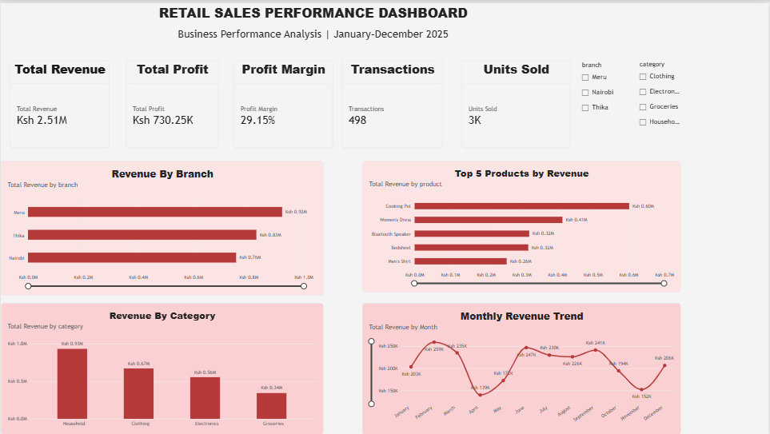

# Retail Sales Analysis and Business Performance Report

## Project Overview

This project demonstrates an end-to-end retail sales analysis workflow using Python, Excel and Power BI.

The goal was to transform raw sales transactions into meaningful business insights that can help a retail business understand its revenue, profitability, branch performance, product demand and sales trends.

The analysis uses a simulated Kenyan retail business operating across three branches: Nairobi, Thika and Meru. The dataset covers transactions recorded between January and December 2025.

**Important:** All data in this project is fictional and was generated for demonstration and portfolio purposes. It does not represent an actual business or client.

## Business Questions

The analysis was designed to answer the following questions:

- How much revenue and profit did the business generate?
- Which branch generated the highest revenue?
- Which product categories contributed most to revenue?
- Which products generated the most sales?
- Which months recorded the strongest and weakest sales?
- Where could management focus its efforts to improve profitability?

## Tools and Technologies

| Tool | Purpose |
|---|---|
| Python | Data processing and automation |
| Pandas | Data cleaning and analysis |
| Excel | Business reporting and analysis |
| OpenPyXL | Excel workbook creation and formatting |
| ReportLab | PDF report generation |
| Power BI Desktop | Interactive dashboard and visualisation |

## Project Workflow

### 1. Dataset Generation

Created a simulated retail sales dataset containing 503 transaction records.

The original dataset deliberately included data-quality issues to make the cleaning process more realistic.

### 2. Data Cleaning and Preparation

Used Python and Pandas to:

- Remove duplicate transaction records.
- Standardise product, category and branch names.
- Correct inconsistent date formats.
- Handle missing values.
- Validate quantities, prices and discounts.
- Calculate gross sales, discounts, revenue, costs and profit.
- Extract year and month information for trend analysis.

After cleaning and validation, **498 transactions** remained in the final dataset.

### 3. Excel Analysis

Created a multi-sheet Excel workbook containing:

- Cleaned transaction data.
- Sales performance summary.
- Branch analysis.
- Product category analysis.
- Monthly sales analysis.
- Charts for visual comparison.

### 4. Business Insights

Used Python to calculate key performance indicators and identify patterns in branch performance, category profitability, product revenue and monthly sales.

### 5. Business Reporting

Generated a PDF business report presenting the key findings, performance indicators and practical recommendations for management.

### 6. Power BI Dashboard

Built an interactive dashboard to make the findings easier to explore and interpret.

The dashboard includes:

- KPI cards for total revenue, total profit, profit margin, transactions and units sold.
- Revenue analysis by branch.
- Revenue analysis by product category.
- Monthly revenue trends.
- Top five products by revenue.
- Interactive branch and category filters.

### Dashboard Preview



The project also includes a PDF export of the Power BI dashboard.

## Key Findings

The analysis produced the following results:

| Business Metric | Result |
|---|---:|
| Total Revenue | KSh 2,505,479.50 |
| Total Profit | KSh 730,249.50 |
| Profit Margin | 29.15% |
| Transactions Analysed | 498 |
| Highest-Revenue Branch | Meru |
| Leading Category by Revenue | Household |
| Best Sales Month | February |

### Branch Performance

Meru generated the highest revenue among the three branches, followed by Thika and Nairobi.

### Product Category Performance

Household products contributed the highest revenue, while groceries had a comparatively low profit margin.

### Monthly Sales Performance

February recorded the highest monthly revenue. April recorded the lowest.

### Leading Products

The five highest-revenue products were:

1. Cooking Pot
2. Women's Dress
3. Bluetooth Speaker
4. Bedsheet
5. Men's Shirt

## Business Recommendations

Based on the findings, the following actions could help management improve business performance:

1. **Investigate branch performance:** Examine the factors contributing to Meru's higher revenue and identify practices that could be applied across other branches.
2. **Review grocery profitability:** Evaluate supplier costs, discounts and pricing to identify opportunities to improve margins.
3. **Monitor product inventory:** Pay attention to high-revenue products to reduce the risk of stock shortages.
4. **Improve sales planning:** Investigate monthly sales fluctuations and use the findings to guide inventory and promotional decisions.
5. **Track profitability:** Monitor profit margins alongside revenue when evaluating products, categories and branches.

These recommendations are based on the simulated dataset and would require validation against actual business records before implementation.

## Project Files

| File | Description |
|---|---|
| `generate_dataset.py` | Generates the simulated transaction data |
| `clean_data.py` | Cleans and validates the dataset |
| `business_insights.py` | Calculates business performance insights |
| `create_excel_report.py` | Creates the Excel workbook |
| `format_excel.py` | Formats the Excel workbook |
| `add_excel_charts.py` | Adds charts to the workbook |
| `generate_business_report.py` | Generates the business PDF report |
| `retail_sales_raw.csv` | Original simulated dataset |
| `retail_sales_clean.csv` | Cleaned transaction dataset |
| `retail_sales_report.xlsx` | Excel analysis workbook |
| `Retail_Sales_Analysis_Report.pdf` | Business performance report |
| `Retail_Sales_Dashboard.pbix` | Interactive Power BI dashboard |
| `Retail_Sales_Dashboard.pdf` | PDF export of the dashboard |
| `dashboard.png` | Dashboard screenshot |

## How to Run the Project

### Requirements

Python 3 and the following packages:

- pandas
- openpyxl
- reportlab

Install the dependencies using:

```bash
python -m pip install pandas openpyxl reportlab
```

### Run the Scripts

Run the scripts from the project directory in the following order:

```bash
python generate_dataset.py
python clean_data.py
python create_excel_report.py
python format_excel.py
python add_excel_charts.py
python business_insights.py
python generate_business_report.py
```

The scripts generate the datasets, Excel workbook and PDF business report.

To explore the interactive dashboard, open `Retail_Sales_Dashboard.pbix` using Power BI Desktop.

## Project Value

This project demonstrates how raw transaction data can be converted into practical business information.

Rather than simply presenting sales figures, the workflow connects data preparation, analysis, visualisation and business recommendations.

The same approach can be adapted to help real businesses understand their sales performance, identify opportunities and make more informed decisions.

## Author

**Eric Mugao**

Python | Data Analysis | Excel | Power BI | Business Reporting

**Portfolio:** https://ericmugao36.github.io

**GitHub:** https://github.com/ericmugao36

---

*Developed as a data analysis portfolio project by Yuri Solutions & Products.*